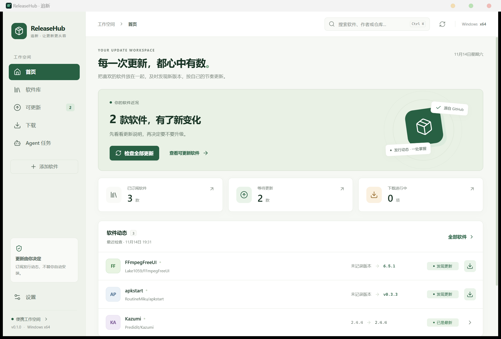

# ReleaseHub · 追新

**把分散的 GitHub 软件更新放在一起。** 面向 Windows 10/11 x64，中文界面、浅色/深色主题、便携数据，不要求注册账户，也不附带模型服务。

[下载发布版本](https://github.com/huai-bot/releasehub/releases) · [便携使用说明](docs/PORTABLE.txt) · [连接 Agent](docs/AGENT_GUIDE.md) · [安全说明](SECURITY.md)



## 开始使用

1. 在发布页下载名称带 **windows-x64-portable.zip** 的文件。
2. 右键 → **全部解压**。把里面的 ReleaseHub 文件夹放到可写的位置，例如 `D:\TOOLS\ReleaseHub`，再打开文件夹中的应用程序。
3. 点击 **添加软件**，粘贴 GitHub 项目地址，选择正式版或包含预览版。
4. 点击 **检查更新**，确认推荐的 Windows 安装包，再下载。
5. 下载结束后点击安装/准备按钮。安装程序会在确认后打开；免安装版只准备到追新自己的目录，不覆盖你的原软件。

也提供名称带 **windows-x64-setup.exe** 的安装版。两种版本都使用系统共享的 Microsoft Edge WebView2；电脑缺少它时，安装版会提示补齐。便携版应先解压，不能直接在压缩包里运行。

> 发布文件未购买商业代码签名证书，Windows 可能显示“未知发布者”。请只从本仓库下载；发行页附有 SHA-256 校验值。

## 能做什么

| 日常操作 | 已提供的功能 |
| --- | --- |
| 集中追新 | 添加仓库、搜索、正式/预览频道、集中检查、发布说明、按软件记住下载偏好 |
| 选对文件 | 识别 Windows/x64，排除其他系统、ARM、源码和辅助组件；无法明确选择时由你确认 |
| 管理下载 | 批量加入队列、进度、取消、失败重试；流式写盘，不将整个安装包放进内存 |
| 检查完整性 | 计算 SHA-256；上游提供摘要时进行比对，只有本地摘要时不会标成“上游校验通过” |
| 安装和更新 | 确认后打开 EXE/MSI 安装程序；ZIP 或已适配的独立 EXE 放入独立受管目录 |
| 保留旧版本 | 列出已准备的免安装版本、打开对应目录、确认后切换当前记录；不删除旧版或混合两版配置 |
| 定时提醒 | 可关闭的定时检查、通知和自动下载；绝不在后台自动运行安装程序 |
| 移动数据 | 便携目录随文件夹移动；订阅导入/导出；搬到新电脑后重新配置本机授权 |
| 与 Agent 协作 | 用户创建锁定源码提交的任务，外部 Agent 认领并报告进度/结果；不内置模型密钥、私人 API 或收费服务 |

**下载完成不等于安装完成。** EXE/MSI 安装器运行后，请在软件详情中按实际情况记录版本。免安装更新使用独立版本目录；需要迁移软件个人配置时，先按上游说明处理，旧目录会保留。

### 首批实际核对的软件

- [FFmpegFreeUI](https://github.com/Lake1059/FFmpegFreeUI)：选择 x64 主程序，不把辅助更新器或 ARM64 程序当成目标。
- [ApkStart](https://github.com/RoutineMiku/apkstart)：区分轻量便携包、完整安装包和独立运行组件包。
- [Kazumi](https://github.com/Predidit/Kazumi)：优先 Windows ZIP，不混入 Android、Linux 或 macOS 文件。

实际检查过这三个仓库的发行记录，并完成 Kazumi Windows ZIP 的真实下载、上游摘要比对和独立目录准备；没有运行或修改用户原有软件。版本号始终从 GitHub 获取，不写死在程序里。[适配资料](docs/upstream-profiles.md)

## 便携和隐私

- 便携发行包包含模式标记，程序把数据库、下载、受管版本和网页组件缓存放在旁边的 `data/` 中。
- 移动之前从右下角托盘菜单选择 **退出**，再移动整个文件夹。重复打开同一份资料库会被拦下。
- GitHub 授权和本机 Agent 密钥只保存在 Windows 凭据管理器，不进入订阅导出文件或官方发行包。
- 在另一台电脑打开时需要重新授权；不要把你用过的完整数据文件夹直接作为“干净安装包”发给别人。
- 不带个人配置的分发请使用本仓库发布的原始便携 ZIP。

公开仓库无需 GitHub 授权即可查询。匿名额度不足时会明确提示；可以等待恢复，或在设置中自行配置只读授权。程序不会借用开发者或 DSH 的登录信息。

## Agent 接入

这是一个**默认关闭的本机任务接口**，不是自动执行代码的后门。

在项目详情创建构建任务后，再到设置开启接入。可信 Agent 使用你显式提供的本机连接信息认领任务，在其获准的独立环境里构建，最后报告 GitHub 产物链接。构建结果会标明不是原作者的官方发行，不自动安装。

接口只提供状态、检查和任务认领/汇报；不提供执行命令、任意文件读写、读取密钥或安装软件的接口。关闭接入会停止服务并清除在途任务票据；轮换密钥则让旧密钥失效。详见 [Agent 使用说明](docs/AGENT_GUIDE.md) 和 [附带的 PowerShell 客户端](integrations/releasehub-agent.ps1)。

## 开发

Tauri 2 + Svelte 5 + TypeScript + Rust + SQLite。当前构建使用 Node.js 26.5.0、pnpm 11.17.0、Rust 1.97.0 和 Windows C++ 构建工具。

```powershell
pnpm install --frozen-lockfile
pnpm check
pnpm test
pnpm build
cargo test --locked --manifest-path src-tauri/Cargo.toml --lib
pnpm desktop
```

浏览器开发预览会明确标出“界面预览”，不会执行检查、下载、安装或保存凭据。正式桌面程序不会在服务失败时偷换成演示数据。

[架构和接口契约](docs/ARCHITECTURE.md) 将发行追踪、下载、便携安装和 Agent 任务分成清晰模块，为未来的个人 GitHub 管理能力保留入口；本版本不实现收藏管理。

[Windows 构建流程](.github/workflows/build-windows.yml) 通过 GitHub Actions 的 **Run workflow** 手动启动，完成检查、测试、EXE/NSIS 编译和干净便携包生成。使用锁定依赖、最小仓库权限，不复制开发者数据或凭据。打包规则见 [打包脚本](scripts/package-windows.ps1)。

## 许可

[MIT](LICENSE) · huai-bot
